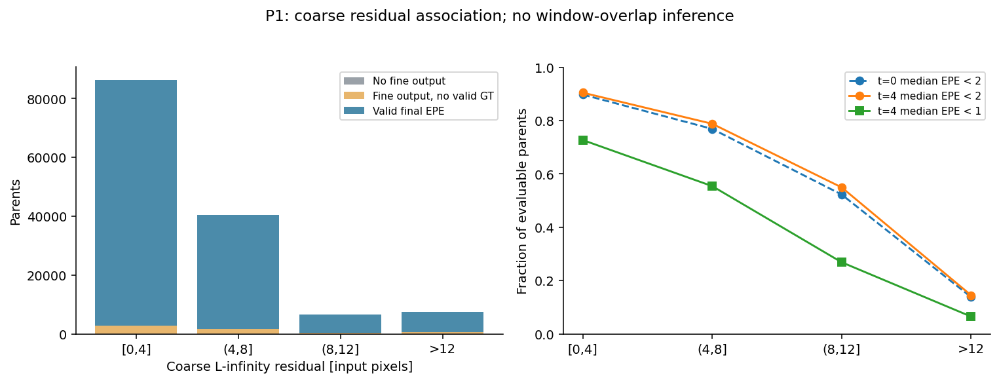
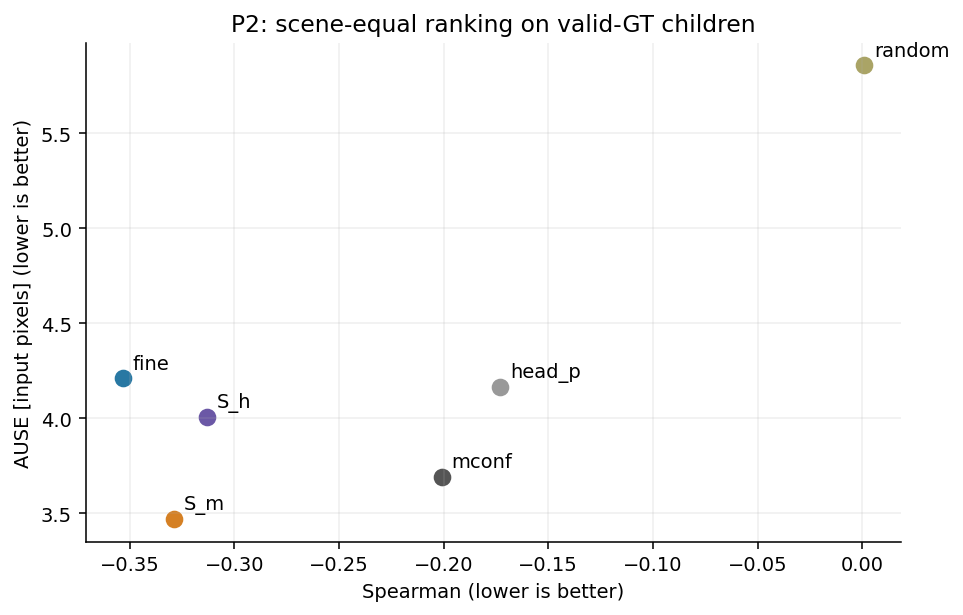
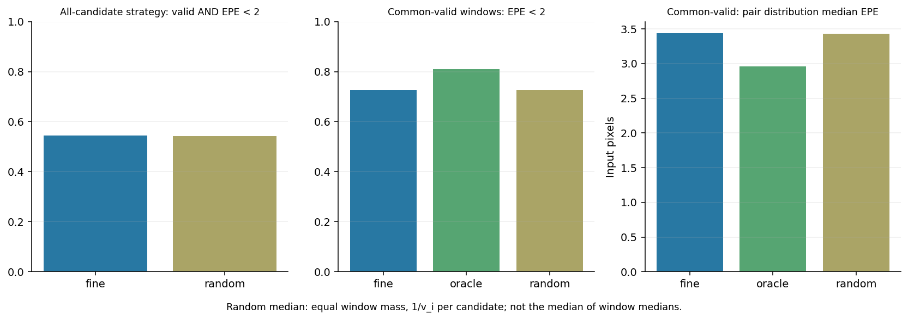
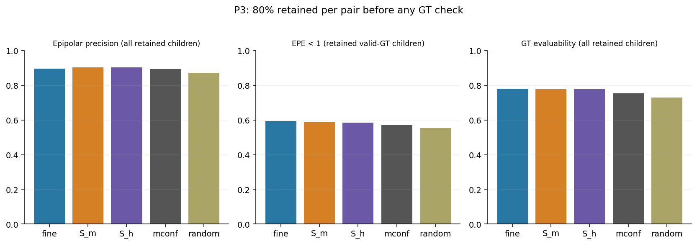
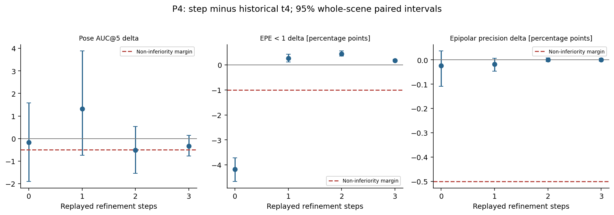

# SLiM Phase 4 分析报告

状态：**completed**。run_id：20261116T193724。核验时间：2026-11-16T20:08:09.179529+08:00。

仅用Phase2/3提交缓存、CPU执行；新前向0、训练更新0、checkpoint写入0。本目录包含全部结论性产物；运行痕迹位于 /home/bupt/projects/SLiM-master/runs/phase4_diag_20261116T193724。

## 四个问题

1. **组合：有折中价值。** 组合弥补了各单项的弱项：mconf 的 Spearman 与 fine 的 AUSE。未达到同时超过两个单项的四项标准；P3实际筛选指标见下文。
2. **同窗口：** fine−随机的<2px正确率差 0.1629 个百分点，95%CI [-0.084817, 0.398085]；上限−fine差 8.1946 个百分点，95%CI [6.703545, 9.797193]。
3. **默认粗因子：S_m。** 优势不明确；默认额外开销更低的 S_m，冻结完整头保留作对照。
4. **少步精修：** G7完整固定序列判定如下；离线通过只支持另行进行真实截断测速，不证明GPU加速。

## P0 验收

身份 1dc74dff202052885202e401ecf8fe44c40714b5877f0f547320aad86661808a 通过；HEAD d9213801860d8d1cef1f3692b3aac5c43b8a4c0e。全部/有效/无有效GT子点为 484473/361254/123219。
历史三分数的Spearman/AUSE复现最大偏差0；历史最终坐标及行序哈希一致，500个基线求解单元直接复用。轨迹重建最大偏差 0.000122070 px < 0.01。
逐字段来源、回执、SHA、派生式：[P0_field_lineage.csv](P0_field_lineage.csv)。验收：[P0_verification.json](P0_verification.json)、[independent_checks.json](independent_checks.json)。

## P1 粗残差分档

角点合同、全部父点汇总。第一层粗残差有效；第二层分母为最终EPE有效父点。该表不能证明两个窗口实际重叠。

| 档 | 父点 | 无细输出 | 有细无GT | 最终有效 | t0<2 | t4<1 | t4<2 | 救回/初始≥2 | 损失/初始<2 |
| --- | --- | --- | --- | --- | --- | --- | --- | --- | --- |
| [0,4] | 86346 | 209 | 2610 | 83527 | 0.897207 | 0.726735 | 0.904306 | 3348/24398 | 1706/166052 |
| (4,8] | 40491 | 207 | 1478 | 38806 | 0.768515 | 0.554064 | 0.787765 | 3063/25017 | 1197/70810 |
| (8,12] | 6689 | 55 | 268 | 6366 | 0.522463 | 0.268615 | 0.549325 | 1087/10210 | 446/10115 |
| >12 | 7472 | 165 | 454 | 6853 | 0.138188 | 0.065081 | 0.145046 | 417/22586 | 224/3069 |

中心残差同表、低纹理、场景等权敏感性：[P1_residual_bins.json](P1_residual_bins.json)、[CSV](P1_residual_bins.csv)。

## P2 固定分数和G5

head_p来自缓存logit的float64 sigmoid；乘积float64。未拟合权重、阈值或温度。父点分数取同一有效子点集合中位数。

| 分数 | Spearman | AUSE | AUROC<1 | AUROC<2 | AUROC<3 |
| --- | --- | --- | --- | --- | --- |
| S_h | -0.312879 | 4.004912 | 0.680478 | 0.708390 | 0.709046 |
| S_m | -0.328661 | 3.469319 | 0.681273 | 0.731658 | 0.745400 |
| fine | -0.353297 | 4.210070 | 0.696368 | 0.715404 | 0.703087 |
| head_p | -0.172966 | 4.164612 | 0.603152 | 0.640085 | 0.657910 |
| mconf | -0.200830 | 3.691596 | 0.608030 | 0.663059 | 0.690803 |
| random | 0.000940 | 5.857710 | 0.501332 | 0.498903 | 0.499848 |

| G5差值 | 值 | 95%CI | 共同pair/scene |
| --- | --- | --- | --- |
| S_m-fine/AUSE | -0.740751 | [-1.436104, -0.292763] | 99/15 |
| S_m-fine/Spearman | 0.024635 | [-0.001900, 0.045788] | 99/15 |
| S_m-mconf/AUSE | -0.222277 | [-0.454669, 0.032966] | 99/15 |
| S_m-mconf/Spearman | -0.127831 | [-0.140849, -0.113248] | 99/15 |

父点、去0003、低纹理：[P2_ranking.json](P2_ranking.json)。全部差值：[P2_paired_differences.csv](P2_paired_differences.csv)。保留曲线：[P2_retention_curves.csv](P2_retention_curves.csv)。分位数/零值/并列：[score_distributions_and_ties.json](score_distributions_and_ties.json)。

## P2b 同窗口选点

实际策略n_i>=2：先在全部候选选点后查GT。共同有效主分析v_i>=2；单有效窗口不并入。值均为pair计算后场景等权。

| 实际策略 | GT可评价率 | 有效且<2概率 | 条件正确率 | 有效且>5概率 | 条件>5率 |
| --- | --- | --- | --- | --- | --- |
| fine | 0.732714 | 0.544317 | 0.731039 | 0.115104 | 0.165250 |
| random | 0.731830 | 0.542097 | 0.729424 | 0.114992 | 0.165501 |

条件正确率为每pair期望正确数与期望可评价数之比。

| 共同有效策略 | EPE<2 | EPE>5 | pair内中位EPE再场景汇总 |
| --- | --- | --- | --- |
| fine | 0.727799 | 0.168513 | 3.433538 |
| oracle | 0.809746 | 0.126863 | 2.956000 |
| random | 0.726171 | 0.168711 | 3.433394 |

**均匀随机选择分布的中位 EPE**：每窗口等权，候选权重1/v_i；每pair对混合分布取加权中位数，再按场景汇总。不是逐窗口中位数的再平均。
分母及n_i/v_i分布：[P2b_window_denominators.json](P2b_window_denominators.json)、[补充分母](P2b_denominator_supplement.json)。低纹理与所有区间：[P2b_within_window.json](P2b_within_window.json)、[配对差值](P2b_paired_differences.json)。

## P3 全子点过滤

每pair在全部细输出子点取ceil(0.8N)，并列按父ID/历史原始行序，再恢复原始顺序。无GT子点参与筛选；保留集合完整可重建。

| 方式 | 保留子点 | 有效GT | 对极精度 | EPE<1 | EPE<2 | GT可评价 | 低纹理保留 | 图0覆盖 | 图1覆盖 |
| --- | --- | --- | --- | --- | --- | --- | --- | --- | --- |
| fine_80 | 387618 | 309704 | 0.895484 | 0.593967 | 0.792722 | 0.780562 | 0.656475 | 0.387944 | 0.398624 |
| S_m_80 | 387618 | 308185 | 0.901808 | 0.589183 | 0.791620 | 0.777153 | 0.650190 | 0.383276 | 0.393181 |
| S_h_80 | 387618 | 308023 | 0.901977 | 0.584606 | 0.783618 | 0.776656 | 0.645233 | 0.379862 | 0.389621 |
| mconf_80 | 387618 | 298877 | 0.893903 | 0.572834 | 0.777689 | 0.753803 | 0.690792 | 0.391093 | 0.401555 |
| random_80 | 387618 | 288899 | 0.870738 | 0.553690 | 0.754780 | 0.728204 | 0.946083 | 0.425813 | 0.435041 |

比例为场景等权；总计数为汇总数，不应直接相除解释加权比例。汇总比例、内点数、50%结果：[P3_filter_quality.csv](P3_filter_quality.csv)。
80%预算下，S_m的对极精度/EPE<1比例为 90.181% / 58.918%；fine为 89.548% / 59.397%；mconf为 89.390% / 57.283%。这体现了对极精度与精细EPE之间的实际折中，不能称为全面超过fine。
G6对极精度差 0.016858 个百分点，95%CI [-0.203465, 0.240119]；ΔSpearman 0.015783，95%CI [-0.000963, 0.033533]。
覆盖代价：[G6.json](G6.json)。所有主指标区间：[P3_paired_differences.json](P3_paired_differences.json)。截断线并列：[P3_cutoff_ties.csv](P3_cutoff_ties.csv)。

| 方式 | AUC@5 | AUC@10 | AUC@20 |
| --- | --- | --- | --- |
| baseline_100 | 61.191301 | 73.577710 | 82.767105 |
| fine_80 | 61.077295 | 73.374083 | 82.320432 |
| S_m_80 | 61.428046 | 73.711934 | 82.938266 |
| S_h_80 | 61.684749 | 74.214445 | 83.054869 |
| mconf_80 | 60.561067 | 73.458723 | 83.264819 |
| random_80 | 61.043830 | 73.559700 | 82.879943 |

位姿为次要指标，100pair合并、五seed分别算AUC后平均；0–100刻度。基线与同预算差值及区间：[P3_pose.json](P3_pose.json)。

## P4 离线精修截断

| t | 平均EPE | pair中位EPE | EPE<1 | EPE<2 | EPE<3 | 对极精度 | AUC@5 | AUC@10 | AUC@20 |
| --- | --- | --- | --- | --- | --- | --- | --- | --- | --- |
| 0 | 8.314266 | 3.124629 | 0.511588 | 0.741612 | 0.809913 | 0.870551 | 61.018816 | 73.714357 | 83.329788 |
| 1 | 8.239977 | 3.022625 | 0.556075 | 0.756749 | 0.814720 | 0.870621 | 62.504608 | 74.590861 | 83.498865 |
| 2 | 8.239195 | 3.019376 | 0.557792 | 0.756538 | 0.814554 | 0.870793 | 60.680213 | 73.141534 | 82.486761 |
| 3 | 8.243779 | 3.025239 | 0.555185 | 0.755867 | 0.814370 | 0.870798 | 60.857396 | 73.445555 | 82.680343 |
| 4 | 8.246527 | 3.028898 | 0.553337 | 0.755447 | 0.814345 | 0.870793 | 61.191301 | 73.577710 | 82.767105 |

G7统一t−t4。比例容差−0.01、−0.005，AUC容差−0.5；t4历史坐标/基线直接复用。

**t=3：精度满足容差，位姿不可确认。**

| 条件 | 差值 | 95%CI | 容差 | 评估 | 确认性 |
| --- | --- | --- | --- | --- | --- |
| AUC@5 | -0.333905 | [-0.777146, 0.146561] | -0.500000 | 非劣效证据不足 | 是 |
| epipolar_precision | 0.000005 | [-0.000062, 0.000069] | -0.005000 | 通过 | 是 |
| precision_lt1 | 0.001847 | [0.001474, 0.002238] | -0.010000 | 通过 | 是 |

**t=2：仅描述：固定序列已在更长步数停止，未进行本档确认性判定。**

| 条件 | 差值 | 95%CI | 容差 | 评估 | 确认性 |
| --- | --- | --- | --- | --- | --- |
| AUC@5 | -0.511088 | [-1.537210, 0.541808] | -0.500000 | 非劣效证据不足 | 否，仅描述 |
| epipolar_precision | -0.000000 | [-0.000077, 0.000083] | -0.005000 | 通过 | 否，仅描述 |
| precision_lt1 | 0.004455 | [0.003499, 0.005582] | -0.010000 | 通过 | 否，仅描述 |

**t=1：仅描述：固定序列已在更长步数停止，未进行本档确认性判定。**

| 条件 | 差值 | 95%CI | 容差 | 评估 | 确认性 |
| --- | --- | --- | --- | --- | --- |
| AUC@5 | 1.313307 | [-0.741925, 3.881841] | -0.500000 | 非劣效证据不足 | 否，仅描述 |
| epipolar_precision | -0.000173 | [-0.000461, 0.000064] | -0.005000 | 通过 | 否，仅描述 |
| precision_lt1 | 0.002738 | [0.001228, 0.004305] | -0.010000 | 通过 | 否，仅描述 |

**t=0：仅描述：固定序列已在更长步数停止，未进行本档确认性判定。**

| 条件 | 差值 | 95%CI | 容差 | 评估 | 确认性 |
| --- | --- | --- | --- | --- | --- |
| AUC@5 | -0.172484 | [-1.900865, 1.578031] | -0.500000 | 非劣效证据不足 | 否，仅描述 |
| epipolar_precision | -0.000242 | [-0.001079, 0.000365] | -0.005000 | 通过 | 否，仅描述 |
| precision_lt1 | -0.041750 | [-0.046612, -0.037150] | -0.010000 | 下降超过预设容差 | 否，仅描述 |

全部误差与位姿差值：[P4_step_differences.json](P4_step_differences.json)、[P4_pose.json](P4_pose.json)。可选阶段耗时缺缓存，已跳过；没有新增计时前向。

## 执行与限制

| 任务 | PID | 开始 | 结束 | worker秒 | 占用MiB |
| --- | --- | --- | --- | --- | --- |
| P0 | 1200233 | 2026-11-16T19:39:33.148529+08:00 | 2026-11-16T19:39:45.490308+08:00 | 8.79 | 83.11 |
| P1 | 1200690 | 2026-11-16T19:41:45.298887+08:00 | 2026-11-16T19:41:53.470186+08:00 | 5.90 | 2.81 |
| P2 | 1200878 | 2026-11-16T19:42:35.773037+08:00 | 2026-11-16T19:43:05.061587+08:00 | 25.92 | 24.95 |
| P2b | 1201827 | 2026-11-16T19:47:01.810186+08:00 | 2026-11-16T19:47:05.895833+08:00 | 2.34 | 34.02 |
| P3 | 1202482 | 2026-11-16T19:50:10.312305+08:00 | 2026-11-16T19:58:49.909917+08:00 | 518.26 | 100.78 |
| P4 | 1204662 | 2026-11-16T20:00:02.173598+08:00 | 2026-11-16T20:06:17.763452+08:00 | 372.61 | 46.98 |

正式几何：P3 5000/5000；P4 2000/2000。已执行失败 0；缺失 0。
P2b空窗口汇总及P3启动前语法这两次新脚本错误均已保存证据并修复，未重复已提交单元。命令、PID、日志/心跳、首20计时与资源：[execution_summary.json](execution_summary.json)。
统计无定义分项：[undefined_and_failure_counts.json](undefined_and_failure_counts.json)。全部口径假设：[protocol_assumptions.json](protocol_assumptions.json)。

- 单训练种子；验证场景参与过BCE-best选轮。
- 100对、15场景；没有独立数据验证组合分数，预设判据只支持下一步选择。
- P2b候选仅限原生已输出子点，不代表所有窗口网格候选。
- P4是离线轨迹重放；未实测真实截断GPU延迟、显存或端到端加速。
- 低纹理仅描述；无定义、几何失败、缺失严格分开。

## 恢复与产物

~~~bash
cd /home/bupt/projects/SLiM-master && /home/bupt/miniconda3/envs/slim/bin/python -B diagnostics_phase4/run_phase4.py --run-id 20261116T193724 --stage remaining --background
~~~

结论性产物均在本目录；图另有SVG。逐项状态和文件大小/SHA：[artifact_manifest.json](artifact_manifest.json)。
