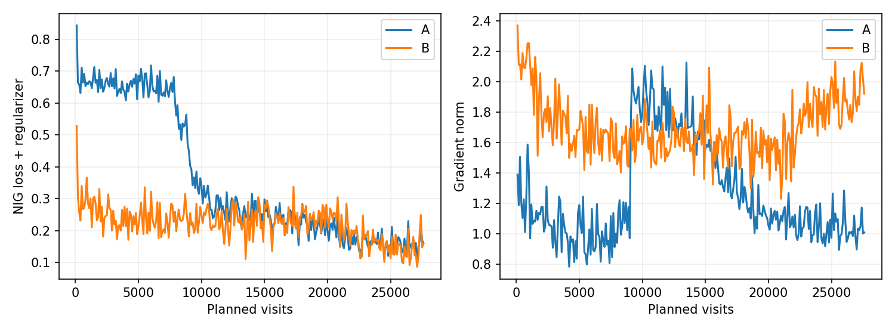
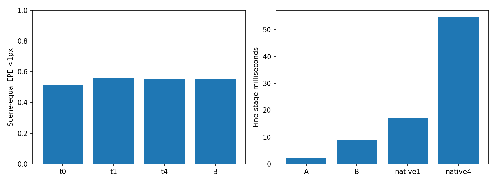
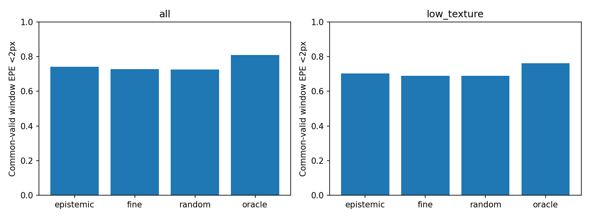

# Phase 5 证据回归细匹配头：最终报告

状态：**completed**。固定第2轮权重；A→B各完成两轮13800次/轮，验证每轮750对，最终100对15场景。

主结果和分母见 [主表](main_table.csv)、[配对差值](paired_differences.csv)、[完整指标](metrics.json)、[判据](decisions.json)。

## 预设判据

|判据|状态|差值 [95% CI]|结论|pair|scene|
|---|---|---|---|---|---|
|G8|completed|-0.004954 [-0.009112, -0.000731]|该指标上达到一步的预设非劣效容差|99|15|
|G9|completed|-0.036917 [-0.050920, -0.024033]|排序优于fine|99|15|
|G10|completed|-0.392503 [-0.426742, -0.354327]|精度部分未满足容差|99|15|

G8只判断B对真实原生一步的EPE<1px；G9只判断同一B误差上的负认知不确定性相对fine的Spearman。G10同时要求共同父窗口<2px非劣效和实际细阶段更快。单项通过不代表整链路替代。

## 身份与运行边界

分支：exp/slim_reliability_v1_20261114T172319；HEAD：527fb3c09090cf40a79aa681caab5791b4a66bf9。冻结digest：1dc74dff202052885202e401ecf8fe44c40714b5877f0f547320aad86661808a。Boot：817dfd85-9798-40e4-bc96-bb39996b2538。

run：/home/bupt/projects/SLiM-master/runs/phase5_20261117T115519。T仅通过报告和进程交接关联；Phase5以原生0.65入口、texture_budget关闭重新加载原权重。原数据、权重、冻结代码和历史run只读。保留启动时19个Phase4 CSV工作区差异。

启动时间：2026-11-17T11:55:22.447425+08:00；本报告时间：2026-11-17T15:03:18.415170+08:00；两任务累计墙钟截至本报告 3.132 小时。最终进程退出时间由delivery receipt补充。

## 低纹理的精确定义

使用送入模型归一化前的 R832 灰度图，像素范围为 [0,1]。以除以 8 的 3×3 Sobel 核计算 gx、gy，每像素纹理能量为 gx²+gy²；全部运算为 float32。

每个原生粗格的零偏移锚点（本设置 stride=8）取16×16邻域，横纵偏移均为 −8…+7。只对有效图像像素求平均：T=有效像素能量之和/有效像素数。外图边界使用复制延拓；遇到内部 padding，Sobel 模板中的无效邻居用当前有效中心像素替换，避免 padding 产生假边缘。窗口无有效像素时为无定义。

低纹理条件为：粗格合法、窗口有效像素数>0、T有限，且 T≤0.0001920461654663086。阈值来自 Phase2 冻结的100个训练pair、1,531,088个合法粗格纹理值的1/3分位数（NumPy linear quantile），不使用GT；后续验证不重新计算分位数，也不保证每张验证图恰好1/3为低纹理。

父匹配使用源图粗格的低纹理身份，其所有子点继承；两图候选纹理分别计算。纹理窗口锚点与GT中心+4是各自的冻结定义。描述子范数筛选另按网络特征的范数计算，T任务把两种量分别记录。


## 结构、数值与来源

|路线|新参数|R(px)|箱数|训练上限/对|结构|
|---|---|---|---|---|---|
|A|154056|8|33|1024|共享双侧：192粗投影+4×48象限投影→128；两侧各2层；融合2层；x/y独立64隐藏|
|B|406432|3|13|2048|96通道6×6；3×3卷积64两层，GN8、padding1；展平→128；x/y独立64隐藏|

新头float32；冻结骨干沿用AMP。AdamW：lr=0.001，weight_decay=0.0001，betas=(0.9,0.999)，eps=1e-8，无scheduler。GradScaler禁用但保存空状态。每轴μ为[-R,R]等距0.5px分箱softmax期望；归一化u=μ/R、y=GT偏移/R。损失为指定NIG NLL与|u−y|(2ν+α)等权之和，按样本和轴平均；ν/β下限1e-6、α−1下限1e-4。两轴方差均值为最终不确定性，方差还原乘R²。

A：源/初始目标均为各自粗格中心+4，冻结192维交互后粗描述子，原生8×8细窗的4×4象限均值按左上、右上、左下、右下拼接。B：原生t0真实子点源/目标，双侧48通道6×6双线性细窗，offset −2.5..2.5、align_corners=False、zero padding，细stride=1。训练仅使用GT有效且L∞严格<R的点；评估不丢弃范围外有效GT。

代码为本次独立实现，没有复制SURE源码。[来源核对](source_reference.json)记录官方SURE提交f702f618ebcf1b13c7c4344e91e56d2131ffc197和文件SHA。NIG通过独立scipy Student-t等价公式校验；正常与极端输入反向均有限。SURE的双向、偶然与认知联合分位筛选不同于本任务固定0→1、负认知排序和ceil固定预算；没有把SURE原设置成绩套用到本实验。

## E0与监督覆盖

|路线|结果|首20 loss|末20 loss|零偏移EPE|200步EPE|恢复参数差|恢复loss差|
|---|---|---|---|---|---|---|---|
|A|pass|1.408549|0.737667|3.792211|3.766609|0.000000|0.000000|
|B|pass|0.976927|0.259180|0.955995|0.924442|0.000000|0.000000|

固定8对、预先落盘的同一监督点集，每路线200次真实更新。原参数与BN、梯度归属和optimizer集合校验通过；第199步保存恢复后的第200步与连续训练一致。自检状态销毁后正式训练seed2026、游标0重新初始化。

固定100对复现194383父点、484473子点、361254有效GT子点；完整前向与截断训练输入最大偏差A=0.0、B=0.0，中心真值、可见mask和父子ID对齐。

初版E0把t4与Phase3重建t4比较，未覆盖Phase4精确终点；该来源差导致约1.6313e-6的比例差，原记录保留。B正式训练前使用本次A验证的完整原生前向缓存补验相同100对，精确t4坐标和EPE与历史均逐元素一致；t0/t1/t4比例均相对Phase4全精度参考差0，见[E0及补验](E0.json)。后续真实一步在同一原生细输入上确实只调用一次RRU，再与计时入口核对。

|路线/层|全部输出|有效GT|范围内|范围外|pooled范围内比例|有效pair|scene|
|---|---|---|---|---|---|---|---|
|A/all|194383|142394|134058|8336|0.941458|99|15|
|A/low_texture|9525|4638|4358|280|0.939629|83|15|
|B/all|484473|361254|296008|65246|0.819390|99|15|
|B/low_texture|26542|13731|11359|2372|0.827252|83|15|

此表比例为pooled；场景等权值与逐场景分母见[监督覆盖](supervision_coverage.json)、[逐对覆盖](supervision_coverage_pairs.csv)。原生四步累计位移观测最大L∞=5.072794 px，超出B单次±3px盒的点数=170；B的预测支持集是每轴[-3,3]，并非原生四步的理论范围。

## 正式训练实绩

|路线|轮|访问|更新|skip|训练秒|验证秒|验证对|
|---|---|---|---|---|---|---|---|
|A|1|13800|13743|57|1531.688214|297.656314|750|
|A|2|13800|13742|58|1507.499221|309.602313|750|
|B|1|13800|13741|59|1735.569494|330.038424|750|
|B|2|13800|13737|63|1698.858803|345.493299|750|

冻结采样计划的前两轮、138个训练场景，未扩样或换序；共54963次正式optimizer更新。每50访问提交原子游标/权重/optimizer/RNG/scaler；epoch末750对验证和last均核验。所有skip原因、计划唯一pair、实际唯一pair、更新唯一pair及资源峰值见[训练实绩](training.json)。最终用第2轮，未以本100对选择轮次。

|路线|计划唯一pair|访问唯一pair|更新唯一pair|物理日志访问|提交访问|skip原因|
|---|---|---|---|---|---|---|
|A|27385|27385|27270|27600|27600|{"no_supervision": 115}|
|B|27385|27385|27263|27600|27600|{"no_supervision": 122}|

[每轮750对验证](validation_by_epoch.csv)给出整体/低纹理/范围内外的均值、中位、<1/<2/<3px和Spearman；A同时列同源零偏移与原生父窗口中位，B列t0、实际t1、t4。

|路线|首50 pair/s|首50时预计剩余小时|峰allocated GiB|峰reserved GiB|峰RSS GiB|
|---|---|---|---|---|---|
|A|4.431421|4.207005|2.166699|8.810547|1.598301|
|B|1.579373|5.609271|2.304499|8.978516|1.850719|



## 数值稳定下限触发率

|路线|监督样本数|ν下限比例|α−1下限比例|β下限比例|
|---|---|---|---|---|
|A|24572642|0.000000|0.806256|0.000156|
|B|54427767|0.000000|0.849357|0.000100|

按每个实际参与损失的样本和坐标轴加权汇总，包含重复访问；不等同于唯一点比例。固定下限保证数值定义，频繁命中表示相应证据参数受下限约束，不能仅凭输出有限或排序相关性宣称方差已校准。训练期间没有调整这些下限。

## First50 total elapsed-time forecast

|Route|Measured first50 time|Elapsed from task start (h)|Remaining forecast (h)|Total from task start (h)|Over16h|
|---|---|---|---|---|---|
|A|2026-11-17T12:25:20.323031+08:00|0.499410|4.207005|4.706415|False|
|B|2026-11-17T13:31:47.844739+08:00|1.607055|5.609271|7.216325|False|

## 最终坐标精度

|口径|方法|平均EPE|中位EPE|<1|<2|<3|
|---|---|---|---|---|---|---|
|B/all|B|8.254379|3.035705|0.551121|0.754710|0.812692|
|B/all|t0|8.314266|3.124629|0.511588|0.741612|0.809913|
|B/all|t1|8.239977|3.022625|0.556075|0.756749|0.814720|
|B/all|t4|8.246527|3.028898|0.553337|0.755447|0.814345|
|B/low_texture|B|8.754934|4.419708|0.490209|0.718807|0.797556|
|B/low_texture|t0|8.812099|4.495534|0.438207|0.705833|0.794703|
|B/low_texture|t1|8.737247|4.385015|0.494106|0.728488|0.799412|
|B/low_texture|t4|8.737793|4.384926|0.485775|0.725404|0.799095|
|A/full/all|A|9.767493|4.734162|0.140096|0.365662|0.570155|
|A/full/all|zero|10.413237|5.549952|0.050530|0.193915|0.398137|
|A/full/low_texture|A|10.231372|6.121364|0.142125|0.376408|0.564966|
|A/full/low_texture|zero|10.871139|6.884163|0.048154|0.198501|0.391822|
|A/median/all|A|9.531284|4.730705|0.141494|0.368481|0.574270|
|A/median/all|native_median|8.346146|3.045053|0.557549|0.760984|0.818586|
|A/median/all|zero|10.184075|5.548768|0.050885|0.195097|0.399478|
|A/median/low_texture|A|9.862144|6.124303|0.145965|0.378120|0.569124|
|A/median/low_texture|native_median|8.773792|4.734442|0.477315|0.706425|0.798787|
|A/median/low_texture|zero|10.517964|6.875309|0.047661|0.196223|0.396253|
|A/fine_one/all|A|9.170203|4.698635|0.141762|0.370041|0.576609|
|A/fine_one/all|native_fine_one|8.036859|3.022047|0.568119|0.763269|0.820928|
|A/fine_one/all|zero|9.825500|5.520972|0.051138|0.195745|0.401148|
|A/fine_one/low_texture|A|9.260089|6.044353|0.145302|0.380553|0.572543|
|A/fine_one/low_texture|native_fine_one|8.019098|4.450318|0.512139|0.733404|0.794286|
|A/fine_one/low_texture|zero|9.902298|6.767842|0.048297|0.198726|0.400451|
|A/joint/all|A|9.170203|4.698635|0.141762|0.370041|0.576609|
|A/joint/all|native_fine_one|8.036859|3.022047|0.568119|0.763269|0.820928|
|A/joint/all|native_median|7.972897|3.025172|0.563029|0.766176|0.822915|
|A/joint/all|zero|9.825500|5.520972|0.051138|0.195745|0.401148|
|A/joint/low_texture|A|9.260089|6.044353|0.145302|0.380553|0.572543|
|A/joint/low_texture|native_fine_one|8.019098|4.450318|0.512139|0.733404|0.794286|
|A/joint/low_texture|native_median|8.166048|4.666696|0.482581|0.708669|0.799816|
|A/joint/low_texture|zero|9.902298|6.767842|0.048297|0.198726|0.400451|

表中为pair内统计→场景内平均→场景等权。B采用相同真实源点、子点ID和有效GT；t1为实际只执行一次精修，t4为真实终点。A的不同源像素比较仅解释为每父窗口输出质量：同源零偏移、原生子点中位EPE、GT不可见的fine最高单子点，均各算真实源点GT。中位参照与一子点参照分别使用共同可评父点，并另给联合共同集；未将无GT等同于错误。

[范围内外、配对区间与逐场景方向](metrics.json)；[A偏移分档及B初始大误差](offset_bins_and_B_initial_tail.csv)；[每对完整输出、排除、32px覆盖](coverage.csv)。A分档[0,4]、(4,8]、(8,12]、>12；恰好8与训练严格<8另记。

|输出层|输出数|有效GT|输出父点|有效GT父点|可评pair|scene|
|---|---|---|---|---|---|---|
|A/all|194383|142394|194383|142394|99|15|
|A/low_texture|9525|4638|9525|4638|83|15|
|B/all|484473|361254|192696|149102|99|15|
|B/low_texture|26542|13731|9162|4840|83|15|

全部分子、分母及无效GT原因见[逐对点分母](point_denominators.csv)，所有比例主表同时提供单列pooled分子/分母，不能把pooled比例当场景等权比例。



## 不确定性与窗口内选择

|口径|分数|ρ(score,EPE)|AUSE|可评pair|scene|
|---|---|---|---|---|---|
|A/all|epistemic|-0.195769|4.614271|99|15|
|A/all|aleatoric|-0.167864|5.154437|99|15|
|A/all|total|-0.195790|4.614546|99|15|
|A/all|mconf|-0.424817|3.755743|99|15|
|A/all|fine|-0.211677|4.451214|99|15|
|A/all|S_m|-0.419070|3.548928|99|15|
|A/full_all|epistemic|-0.200166|4.563457|99|15|
|A/full_all|aleatoric|-0.171241|5.159120|99|15|
|A/full_all|total|-0.200187|4.563750|99|15|
|A/full_all|mconf|-0.424219|3.846460|99|15|
|A/low_texture|epistemic|-0.122967|5.377392|82|15|
|A/low_texture|aleatoric|-0.090193|6.067359|82|15|
|A/low_texture|total|-0.122817|5.377499|82|15|
|A/low_texture|mconf|-0.362010|3.995580|82|15|
|A/low_texture|fine|-0.252879|3.856413|82|15|
|A/low_texture|S_m|-0.373637|3.624091|82|15|
|A/full_low_texture|epistemic|-0.106222|5.465502|82|15|
|A/full_low_texture|aleatoric|-0.089627|6.036433|82|15|
|A/full_low_texture|total|-0.106072|5.465595|82|15|
|A/full_low_texture|mconf|-0.376860|4.043376|82|15|
|B/all|epistemic|-0.388336|3.765836|99|15|
|B/all|aleatoric|-0.333059|3.971158|99|15|
|B/all|total|-0.388339|3.765088|99|15|
|B/all|mconf|-0.201066|3.696902|99|15|
|B/all|fine|-0.351419|4.211332|99|15|
|B/all|S_m|-0.327481|3.473045|99|15|
|B/low_texture|epistemic|-0.276144|3.784024|83|15|
|B/low_texture|aleatoric|-0.205239|3.852201|83|15|
|B/low_texture|total|-0.276251|3.783607|83|15|
|B/low_texture|mconf|-0.165317|3.865345|82|15|
|B/low_texture|fine|-0.261463|3.830285|83|15|
|B/low_texture|S_m|-0.260204|3.420807|83|15|

分数越大代表越可信，所以与EPE的相关系数越负越好。主分数为负认知不确定性；偶然和两者之和仅探索。每条路线的全部分数比较使用该路线自己的同一坐标误差；A父级fine/S_m是离线原生实际子点中位，仅在共同可关联父点比较，不能算作A部署能力。独立的A完整输出分母另列。常量、样本不足分别记undefined；两种不确定性之间相关与0.1–1.0保留曲线见[指标](metrics.json)、[曲线](retention_curves.json)。

|区域|全部窗口|实际≥2候选|有效GT≥2|仅1有效|无有效|共同口径pair|scene|
|---|---|---|---|---|---|---|---|
|all|192696|122521|95122|53980|43594|81|15|
|low_texture|9162|6700|3854|986|4322|66|15|

|窗口口径|方式|GT可评率|有效且正确概率|条件<2|条件>5|中位EPE|
|---|---|---|---|---|---|---|
|all/actual|epistemic|0.733702|0.555836|0.747865|0.154459|无定义|
|all/actual|fine|0.732714|0.543902|0.731122|0.166112|无定义|
|all/actual|random|0.731830|0.541610|0.729195|0.166226|无定义|
|all/actual|oracle|0.773054|0.624632|0.799232|0.133831|无定义|
|all/common|epistemic|无定义|无定义|0.742118|0.159782|3.388210|
|all/common|fine|无定义|无定义|0.727551|0.169300|3.432041|
|all/common|random|无定义|无定义|0.725715|0.169439|3.438597|
|all/common|oracle|无定义|无定义|0.810164|0.126764|2.955615|
|low_texture/actual|epistemic|0.382060|0.269702|0.710163|0.172848|无定义|
|low_texture/actual|fine|0.377490|0.260132|0.692508|0.180018|无定义|
|low_texture/actual|random|0.378450|0.263607|0.685189|0.181006|无定义|
|low_texture/actual|oracle|0.405520|0.306994|0.745330|0.149285|无定义|
|low_texture/common|epistemic|无定义|无定义|0.702051|0.168241|5.231438|
|low_texture/common|fine|无定义|无定义|0.688960|0.180524|5.347788|
|low_texture/common|random|无定义|无定义|0.690215|0.176871|5.145774|
|low_texture/common|oracle|无定义|无定义|0.760742|0.134385|4.795361|

实际口径：在所有实际子点上先选后查GT，窗口需至少2个实际子点；oracle只作有GT时离线上限。随机每窗口等权，分别使用v/n、g/n及Σ(g/n)/Σ(v/n)，坏点同理。共同口径：至少2个有效GT候选，随机中位名称为“均匀随机选择分布的中位 EPE”，窗口内权重1/v，先求每pair混合分布加权中位，再场景汇总。

主信号−fine、主信号−随机、oracle−主信号的场景配对区间完整列在[差值表](paired_differences.csv)。低纹理仅作描述，分母独立列出，不以整体Spearman代替低纹理同窗口效果。



## 固定预算过滤与几何

在全部预测点上保留ceil(0.95N)与ceil(0.8N)，随后恢复原始顺序。A按负认知；B另列S_m和冻结seed随机。GT未参与筛选。具体截取并列按父点ID、原始子点顺序；原始顺序是父点块内原生torch.topk细置信度降序，原生完全并列保留框架的原始输出顺序。Spearman、AUSE和曲线沿用冻结函数自己的并列规则。

[筛选质量、低纹理父点保留和覆盖](filter_counts.json)、[截断线并列数量](filter_ties.csv)提供每pair的完整分母。低纹理父点保留分母为筛前已有实际输出的低纹理父点。两图覆盖使用有效输入区域32px网格；包含无GT预测。

位姿状态：completed；新增求解2000，原生复用500，已执行失败0，缺失0。canonical LO-RANSAC，原图坐标/K，0.5px，confidence0.99999，seed0–4。每seed合并100对算AUC后平均，0–100刻度；失败计∞，未执行单列；场景bootstrap整块保留所有方法与seed并重算AUC。

|方法|AUC@5|AUC@10|AUC@20|
|---|---|---|---|
|native|61.191301|73.577710|82.767105|
|A_all|36.741271|48.942240|60.276010|
|A_95|37.356263|49.309374|61.226071|
|B_all|62.090981|74.807769|84.053750|
|B_95|61.865163|74.510963|83.844964|

[位姿差值、场景区间和逐场景方向](pose.json)；逐单元匹配数、求解状态、内点数与耗时留在run/geometry/geometry_units.csv。

## Geometry unit denominators

|Method|Units|Pairs|Successes|Executed failures|Mean matches|Mean inliers (all)|Mean inliers (success)|
|---|---|---|---|---|---|---|---|
|native|500|100|500|0|4844.730000|2348.556000|2348.556000|
|A_all|500|100|500|0|1943.830000|531.988000|531.988000|
|A_95|500|100|500|0|1847.090000|524.566000|524.566000|
|B_all|500|100|500|0|4844.730000|2351.212000|2351.212000|
|B_95|500|100|500|0|4602.960000|2312.780000|2312.780000|

## 实际替代路径效率

|路径|场景等权ms|pair|输出最大偏差|allocated GiB|reserved GiB|
|---|---|---|---|---|---|
|A|2.371563|100|0.000000|0.358090|3.093750|
|B|8.833565|100|0.000000|0.498920|3.093750|
|native1|16.970247|100|0.000000|2.112624|3.093750|
|native4|54.590655|100|0.000000|2.112759|3.093750|

共同起点：交互后粗描述子、已匹配粗父点、上采样细特征；终点：全部实际输出源/目标坐标。每对每法预热，再CUDA同步重复3次取中位；窗口构造、采样、池化、预测与坐标解码均计入，GT/统计/落盘排除。路径证明native1只执行1次RRU，native4为4次；A不执行细相关或RRU；B执行细相关而不执行RRU。未使用训练点数上限。

共同上游特征生成单列：场景等权 35.644958 ms。[路径证明与峰值边界](efficiency_proof.json)、[逐对时间](efficiency_pairs.csv)、[配对时间差](efficiency.json)。allocated包含共同常驻张量；reserved是进程分配器保留的池峰值，不代表该算子的净增显存。细阶段差异不能外推端到端加速。

## 资源、故障与复现

启动Linux可用593.109 GiB，C卷56.925 GiB；VHD和实际swap同处C卷，只计算一次宿主容量。预算新增8GiB并保留2GiB。VHD：C:\Users\bupt\AppData\Local\wsl\{2ffa190c-d4f2-4f32-98e4-e3c6b0721fed}\ext4.vhdx；swap：C:\Users\bupt\AppData\Local\Temp\017C467D-EB94-47CD-A037-D966E1A773EA\swap.vhdx。

启动进行了小规模真实读取和独立run写入/fsync/回读/清理。全boot历史日志流式检查后用游标续查；启动早期journal非正常关闭警告保留，未把它当作本次新存储故障。各运行阶段5秒watchdog检查存储、容量和存活；运行期低于2GiB安全暂停，系统存储错误立即停止且不强写新checkpoint。

采样观测P5 run峰值2.814 GiB，宿主最小余量50.532 GiB。这是30秒观测峰值，瞬时原子checkpoint临时副本另外至多增加一个payload，不能称连续测得的绝对峰值。

第一次E0在首个pair提交前遇到bilinear采样dtype实现错误，恢复原生AMP上下文后重跑，未产生训练更新；失败日志保留。初版t4参考缺项及补验也单独保留。训练数值核心/采样/超参数未在结果出来后调整。降级记录：null。

[全部阶段命令/PID/时间/故障](stages.json)、[checkpoint绝对路径、大小与SHA256](checkpoints.json)、[产物清单](artifact_manifest.json)。大于10MB明细保留run；每个结果目录限50MB。源码位于evidential_fine/，冻结目录未改。

在仓库目录使用以下入口；已有训练进度仅使用同配置恢复，已完成的训练不要再次启动：

```bash
cd /home/bupt/projects/SLiM-master
/home/bupt/miniconda3/envs/slim/bin/python -B evidential_fine/run_phase5.py --run /home/bupt/projects/SLiM-master/runs/phase5_20261117T115519 --stage A --background --resume
/home/bupt/miniconda3/envs/slim/bin/python -B evidential_fine/run_phase5.py --run /home/bupt/projects/SLiM-master/runs/phase5_20261117T115519 --stage B --background --resume
/home/bupt/miniconda3/envs/slim/bin/python -B evidential_fine/run_phase5.py --run /home/bupt/projects/SLiM-master/runs/phase5_20261117T115519 --stage evaluate --background --resume
/home/bupt/miniconda3/envs/slim/bin/python -B evidential_fine/run_phase5.py --run /home/bupt/projects/SLiM-master/runs/phase5_20261117T115519 --stage report --background --resume
```

## Control connection incident

A new WSL shell returned 0x8007274c while the existing A worker and watchdog continued updating. Host available memory was 0.691GiB at the recorded sample. Plain bupt connections with an explicit Linux cwd later succeeded; boot was unchanged. Incremental kernel records were UtilAcceptVsock warnings, with no detected new storage fault. The cause is not proven; no system/configuration changes, restarts, or training retry occurred. See [incident evidence](control_connection_incident.json).

The serial coordinator launch and actual stage handoffs are retained under run/chain/. CPU synthetic checks caught undefined scene-interval handling and duplicate CSV metadata, corrected before formal final statistics; failure records remain under run/checks/.

## 解释边界与下一项最小实验

B共同有效窗口主信号−fine的<2px差值：0.014568 [0.010948, 0.019375]。整体相关性与窗口内收益是不同结论；同样，坐标精度和候选召回不可互相替代。

仅一个训练seed、冻结采样计划前两轮、冻结SLiM、R832、100对15个室外验证场景；最终样本已被反复分析。低纹理使用Phase2训练集冻结阈值0.0001920461654663086，源父点随源粗格、子点继承；并非按本次GT/成绩挑选。该成绩既不是测试集泛化证明，也不是联合训练的严格上下界。

坐标、排序和同窗口选择分别审视。优先重复同一冻结方案的一个独立训练种子以检验主结论；若主要收益只出现在排序，应固定原生一步坐标，单独验证窗口内选择；候选召回的后续依据独立T判据，不能借调P5阈值。 本次只给建议，解冻、扩样、标签改动和测试集评测均未执行。

## 效率入口的一次实现修复

首对计时曾因 B 整批头计算与完整评估的 4096 分块不同而触发坐标一致性门禁。单对独立探针测得：偏移最大差 8.046627e-7 px，坐标相加后最大差 6.103516e-5 px；采用完整评估原有分块后，偏移和坐标差均为 0。A 同对无差异。

仅将计时入口统一为相同 4096 分块，全部子点仍参与，GPU 窗口提取、分块头计算、拼接和坐标解码均计时。精度、尺寸、阈值、输出预算及 1e-5 验收容差不变。失败前没有效率单元提交，修复后 100 对统一测量；已提交的 A/B 最终 100 对缓存、两轮训练和 checkpoint 均未重跑或改写。故障日志和修复前代码保留，见[定位与修复证据](efficiency_correction.json)。


## Final stopped-state acceptance

Verified at 2026-11-17T15:10:00.861787+08:00. Both training routes, final 100-pair evaluation per route, 100-pair efficiency measurement, 2,000 new geometry units, report, coordinator and resource observer have completed. No owned processes remain. Total wall time from both-task startup: 3.244 hours. See [final acceptance](final_acceptance.json) for the complete state, resource observations, preserved Git differences and decisions. Immutable artifact checksums are in [the manifest](artifact_manifest.json); the manifest checksum itself is in the run-level final delivery receipt.
