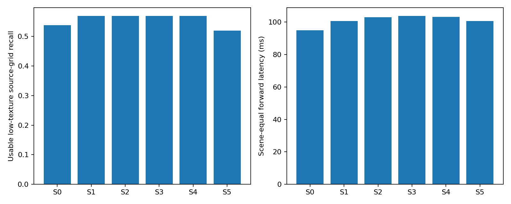
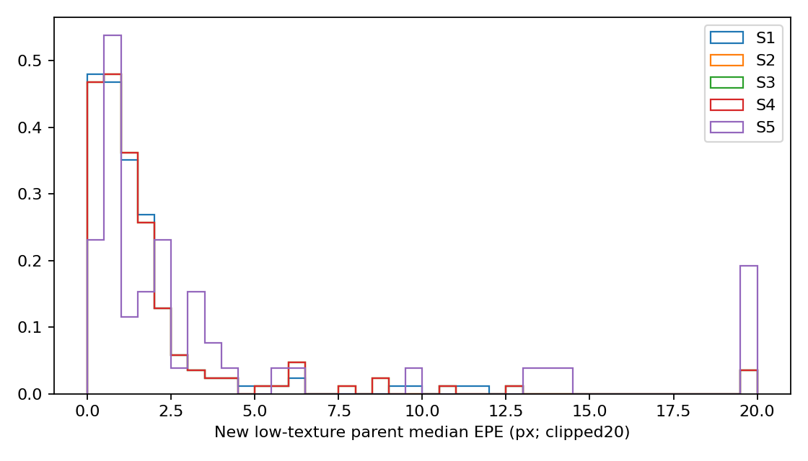

# Phase T 范数阈值与低纹理候选扫描

Run: phaseT_20261117T115519；冻结身份 1dc74dff202052885202e401ecf8fe44c40714b5877f0f547320aad86661808a。

状态：completed。完整统计 [summary.json](summary.json)，判据 [decisions.json](decisions.json)。

|设置|完成/100|父点|有效GT子点|低纹理主召回|前向秒|
|---|---:|---:|---:|---:|---:|
|S0|100|194383|361254|0.538336|0.094865|
|S1|100|209166|359029|0.568936|0.100641|
|S2|100|209333|357684|0.568936|0.102966|
|S3|100|209335|357684|0.568936|0.103730|
|S4|100|209335|357684|0.568936|0.103152|
|S5|100|184894|369422|0.520289|0.100640|

## 预设判据

GT1: {"status": "completed", "value": {"metric": "low_recall", "comparison": "S2-S0", "pair_count": 87, "scene_count": 15, "mean_difference": 0.03059940392938685, "win": 3, "tie": 9, "loss": 3, "ci95": [-0.00028967854985996954, 0.08161001715031645], "bootstrap_replicates": 2000, "seed": 2026, "limitation": "single training seed; validation participates in selection"}, "conclusion": "增量有限或证据不足"}

GT2: {"status": "completed", "good": 134, "evaluable": 171, "added_total": 3108, "proportion": 0.783625730994152, "GT_evaluable_rate": 0.05501930501930502, "conclusion": "可评价新增匹配多数正确"}

GT3: {"status": "completed", "budget_equal": true, "recall": {"metric": "low_recall", "comparison": "S5-S0", "pair_count": 87, "scene_count": 15, "mean_difference": -0.01804710853569392, "win": 4, "tie": 4, "loss": 7, "ci95": [-0.05271684975506316, 0.0018825431523373235], "bootstrap_replicates": 2000, "seed": 2026, "limitation": "single training seed; validation participates in selection"}, "time_ratio": 1.061395967294393, "passed": false, "unmet": ["recall_lower_gt0"]}

## 分母和质量

源格中心+4，GT可见且映射到有效目标粗格才进入固定分母；目标格用半开区间。每源格每阶段一票。主召回允许任意父目标格产生EPE<2px有效子点。误差用子点自身真实源坐标。

[逐阶段去向](grid_funnel.csv)、[质量](quality.csv)、[预算](candidate_budget.csv)、[范数通过率](norm_pass.csv)、[净增](source_grid_changes.json)、[新增AUROC](new_parent_AUROC.csv)、[80%筛选](filter80.json)。

父级fine取全部实际子点分数中位数，S_m=mconf×fine；先筛后查GT。无细输出、无GT、单类undefined分别保留。源低纹理跟随冻结源粗格，两图候选纹理分别计算。

## 计时与几何

每对完整预热1次，同步计时3次取中位数；GT、统计及保存不进计时。粗上限6000；细预算按父点分配top-k后再应用全局相对阈值。触顶和截断计数见预算表。段时间来自原生CUDA timer。

位姿状态：completed；[pose.json](pose.json)。原生500单元经坐标、行序、协议和提交哈希核验后复用；求解失败计无限误差，未执行不进分母。

## 范围与交接

仅适用于该R832室外、冻结纹理和可见性、反复分析的100对15场景验证样本，不外推测试集或联合训练。T没有checkpoint、新头或optimizer。各worker退出前恢复入口并check_frozen。Phase5新进程重载原权重，独立E0。

完整命令、PID、耗时、资源、故障、回执和大明细：/home/bupt/projects/SLiM-master/runs/phaseT_20261117T115519

续扫：/home/bupt/miniconda3/envs/slim/bin/python -B diagnostics_threshold/run_threshold.py --run /home/bupt/projects/SLiM-master/runs/phaseT_20261117T115519 --background --resume

续几何/报告：/home/bupt/miniconda3/envs/slim/bin/python -B diagnostics_threshold/finish_T.py --run /home/bupt/projects/SLiM-master/runs/phaseT_20261117T115519

已有提交先验证再复用。降级记录：null

## 补充分母、资源与结果解释

|低纹理S0阶段|分子|固定分母|pooled比例|场景等权比例|
|---|---|---|---|---|
|source_pass|7793|7954|0.979759|0.955635|
|target_pass|7867|7954|0.989062|0.984216|
|both_pass|7728|7954|0.971587|0.945433|
|correct_parent|3576|7954|0.449585|0.531922|
|correct_parent_fine|3549|7954|0.446191|0.528897|
|correct_parent_good|3195|7954|0.401685|0.464181|
|any_parent|4190|7954|0.526779|0.658616|
|any_good|3486|7954|0.43827|0.538336|
|has_evaluable_child|4013|7954|0.504526|0.628889|

在固定7954个可见低纹理源格分母上，7728个正确格对两侧均通过范数筛选，但仅3576个实际成为正确粗父点，流失4152个。对应场景等权比例从0.945433降到0.531922，正确格路径最大损失在两侧通过之后的粗匹配转化。主召回允许任意目标父格，S0为0.538336，不能和“正确父点产生好子点”分支混用。此结论仅针对当前可见源格分母，不推断被遮挡或不可投影区域。

GT1的S2−S0主召回为+3.060个百分点，95%区间[-0.029,8.161]个百分点，证据不足。GT2的134/171=78.363%只覆盖3108新增低纹理父点中的5.502%，不能称全部新增父点大多正确。GT3预算严格相同，但召回差区间下界未大于0；时间比1.0614通过≤1.10条件，联合判据不通过。

|设置|完成对|计时前向|allocated峰GiB|reserved峰GiB|粗上限触顶对|细预算限制对|
|---|---|---|---|---|---|---|
|S0|100|300|2.157|3.0879|16|98|
|S1|100|300|2.157|3.6602|75|100|
|S2|100|300|2.157|3.666|100|100|
|S3|100|300|2.157|3.666|100|100|
|S4|100|300|2.157|3.666|100|100|
|S5|100|300|2.1572|3.0879|16|98|

每对每档warmup1次加正式计时3次，共1800次正式计时前向、600次warmup；全部600设置单元完成。既有细预算是每父点top-k分配后再相对阈值，并非简单全局6000截断。触顶前后计数见[candidate_budget.csv](candidate_budget.csv)。CUDA段计时仅作描述，统计hook与GT不计入。

逐档真实命令、PID、退出状态和恢复清理：[runtime_summary.json](runtime_summary.json)。本次新增2500位姿求解，原生500单元核验后复用；无T训练或checkpoint。T开始11:59:29，全部报告/几何于12:16:59完成；后续仅整理已提交CPU证据。

低纹理沿用Phase2训练集校准的Sobel局部能量阈值0.0001920461654663086；源粗格的标签由子点继承，不由GT或本次成绩定义。[逐阶段汇总](grid_funnel_summary.json)、[主要流失判断](largest_low_texture_loss.json)。通用bootstrap返回的“single training seed”元数据来自复用函数，T本身没有训练种子；T区间的抽样单位是场景。

原始报告和原清单保存在run/report_versions/，本次补充不重跑或覆盖任何有效pair缓存。

Strict parent-median EPE<5px counts and scene-equal values: [parent_lt5.csv](parent_lt5.csv), [summary](parent_lt5_summary.json). Equality at5px is counted separately; this is not computed by complementing >5px. Four strata are all, low texture, added, and added low texture.

## 低纹理的精确定义

使用送入模型归一化前的 R832 灰度图，像素范围为 [0,1]。以除以 8 的 3×3 Sobel 核计算 gx、gy，每像素纹理能量为 gx²+gy²；全部运算为 float32。

每个原生粗格的零偏移锚点（本设置 stride=8）取16×16邻域，横纵偏移均为 −8…+7。只对有效图像像素求平均：T=有效像素能量之和/有效像素数。外图边界使用复制延拓；遇到内部 padding，Sobel 模板中的无效邻居用当前有效中心像素替换，避免 padding 产生假边缘。窗口无有效像素时为无定义。

低纹理条件为：粗格合法、窗口有效像素数>0、T有限，且 T≤0.0001920461654663086。阈值来自 Phase2 冻结的100个训练pair、1,531,088个合法粗格纹理值的1/3分位数（NumPy linear quantile），不使用GT；后续验证不重新计算分位数，也不保证每张验证图恰好1/3为低纹理。

父匹配使用源图粗格的低纹理身份，其所有子点继承；两图候选纹理分别计算。纹理窗口锚点与GT中心+4是各自的冻结定义。描述子范数筛选另按网络特征的范数计算，T任务把两种量分别记录。

